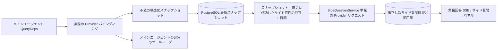

# ARTEX `/btw` サイド質問

日本語 · [한국어](README.md) · [中文](README.zh.md)

通常のチャット、タスクの MainAgent、および現在のタスクが直接起動した Worker は、それぞれ本文の会話から切り離されたサイド質問をサポートします。メイン入力欄に `/btw 質問` と入力するとサイド質問を送信でき、内容を入れずに `/btw` とだけ入力するか「サイド質問」ボタンを押すと、以前のサイド質問の履歴が開きます。デスクトップでは幅を調整できるサイドバーとして、モバイルではドロワー（Drawer）として表示します。

サイド質問への回答は、質問を送信した時点のエージェントのコンテキストスナップショットをもとに生成され、ストリーミング表示・追加質問・停止・クリアに対応しています。パネルを閉じても、ページを再読み込みしても、SSE 接続が切れても、モデルへのリクエストはキャンセルされません。停止は現在進行中のサイド質問 1 件だけに影響し、クリアはサイド質問をキャンセルしたうえでサイド質問の履歴も削除しますが、本文のコンテキストスナップショットはそのまま残します。

> この文書は原文の中国語文書（`README.zh.md`）を韓国語に翻訳したものです。上流（upstream）リポジトリの変更と照合しやすいように、原文はそのまま保存しています。

## 実装範囲

Go、norma v0.3.7、Next.js、そして既存の Markdown・ResizablePanel・Drawer・AlertDialog コンポーネントをそのまま使用しており、norma のソースコードは変更せず、サイド質問のために新しい依存関係も追加していません。Planner、他のタスクから引き継いだ Worker、ツール型サブタスクの昇格は今回の範囲には含まれません。

- `capture.go` は `Options.Deps.CallModel`・`CallModelSync` からのリクエストだけをメインループのリクエストとしてマークします。Provider デコレーターはそれぞれのモデルの内部、つまりルーティングプールの外側でモデルが選ばれた後の段階に位置するため、実際に選択されたモデルを記録します。圧縮リクエストと要約リクエストはスナップショットを上書きしません。
- リクエストの開始時点、モデルが応答を完結させた時点、実行が終了状態に達した時点でスナップショットを発行します。生成途中の中途半端な応答は発行しません。ツール呼び出しは norma の `MessagesForAPI` を経由して対応関係を保ち、ツールの結果は次のメインモデルのリクエスト、または実行の終了状態でスナップショットに入ります。ストリーミングが中断された場合は、直前の有効な境界を維持します。
- スナップショットは JSON のディープコピーによって、構造化メッセージ、システムプロンプト、ツール定義、生成パラメータを保持します。モデルの推論はスナップショットのロックもデータベーストランザクションも保持しません。
- `SideQuestionService` は個々の Provider を呼び出します。必要に応じて先にサイド質問用の要約を作成し、最終回答は、コンテキストが初めて上限を超え、まだテキストもツール呼び出しも出力していない場合に限り、一度だけ縮小して再試行します。エージェントセッションは新たに作成せず、ツール実行器・メインの transcript・アクティビティストリーム・タスクグラフには接続せず、タスクのモデル切り替えチェーンも経由しません。回答がツール定義を保持するのは、既存の構造化ツールコンテキストとの互換性のためであり、要約リクエストにはツールを提供しません。新たに返されたツール呼び出しには実行経路がありません。
- 上位セッションごとに実行中のリクエストは 1 件、サービスプロセス 1 つあたり最大 4 件、リクエスト 1 件の制限時間は 120 秒です。サイド質問はサービスのライフサイクルの下で、独立したキャンセルコンテキストを使用します。
- サイド質問のリクエストは、モデル設定への参照と機密情報を含まない識別情報の要約を保持し、リクエスト時に既存の設定から認証情報を取得します。設定が削除されたり、モデル・プロトコル・アドレスなどの識別フィールドが変わったりした場合は、先にメインエージェントを実行してスナップショットを更新するよう求めます。テストは製品のデフォルトモデルを変更しません。

## 永続化と復旧

`db/schema.sql` は `side_question_sessions` と `side_question_requests` テーブルを自動的に作成します。前者は上位リソース、最新スナップショット、実行番号、バージョン、クリーンアップバージョンを保存し、後者は質問、累積回答、状態、モデル、スナップショット時刻、使用量、イベント順序番号、ページ順序番号を保存します。

上位セッションのキーには conversation ID を使うか、task ID・exploration ID・intent ID をまとめて使います。Worker は再利用可能な実行スロット名を使いません。

スナップショットは上位セッション単位でマージして記録し、250 ミリ秒ごとに 1 回反映します。データベースは `(run_id, version)` を比較し、古いバージョンが新しいバージョンを上書きするのを防ぎます。サイド質問を送信する直前に、選択したスナップショットをもう一度保存します。保存に成功すると、メモリ上にあった大きなスナップショットを解放し、失敗した場合は、まだ記録できていないバージョンを残しておきます。累積回答の内容はストリーミングイベントが届いたときに最大 250 ミリ秒に 1 回記録し、終了状態では即座に保存します。データベースエラーが発生した場合は、回数を制限して再試行します。

サービス起動時に、以前 `running` 状態のまま残っていたリクエストを `interrupted` とマークし、すでにデータベースに保存されている一部の回答と使用量はそのまま残します。リクエストは自動的には再実行しません。直近で正常に保存されたコンテキストは、次の質問にすぐ使えます。古いセッションにスナップショットがない場合は、先にメインエージェントを実行するよう求め、UI のアクティビティ記録からコンテキストを再構築することはしません。

クリア操作はクリアバージョンを 1 つ上げてリクエストを削除し、条件付き更新によって遅れて届いたコールバックが再び書き込まれるのを防ぎます。上位リソースを物理的に削除する場合は外部キーのカスケードに任せ、Worker を論理的に削除する場合は、同じトランザクション内でサイド質問のデータも一緒に削除し、その後に遅れて届くスナップショットを拒否します。タスクをアーカイブする際は、まず新しいリクエストをブロックし、メインフローが停止するのを待ち、サイド質問をキャンセルしたうえで、データベースへの反映を待ちます。アーカイブ形式は v3 で、サイド質問テーブルのない v1・v2 とも互換性があります。

履歴は欠けることなく保存し、順序番号カーソルに基づいて 1 ページあたり最大 20 件を返します。モデルへのリクエストには、直近で成功した問答の原文を最大 20 組まで再度含めますが、その分量はトークン予算で制限し、それより古い問答は別途ローリング要約で管理します。本文のコンテキストが予算を超えた場合は、サイド質問用のコピーの古い部分だけを要約し、直近の構造化ツール呼び出しとその結果は残します。要約・準備の進行状況・使用量は、すべてサイド質問の同時実行・キャンセル・120 秒の制限時間のルールに含まれます。詳細は [コンテキスト予算とオープンソースの参考資料（CONTEXT_BUDGET.ja.md）](CONTEXT_BUDGET.ja.md) を参照してください。

## HTTP 契約

以下のパスを `{parent}` として使い、既存の認証とリソース検証にそのまま従います。

- `/api/conversations/{id}`
- `/api/tasks/{id}/chat`
- `/api/tasks/{id}/intents/{iid}`

リクエストごとの返却と動作は次のとおりです。

- `GET {parent}/side-questions?before={ordinal}` は `items` を新しい順に並べて返し、あわせて進行中の実行状態（`current`）、スナップショットのメタ情報（`snapshot`）、次のカーソル（`next_cursor`）を返します。カーソルが 0 の場合は、最新ページであるか、次のページがないことを意味します。
- `POST {parent}/side-questions` は `{ "question": "…", "client_request_id": "UUID" }` 形式の JSON を受け取ります。新しいリクエストであれば 202 とともにリクエストオブジェクトを返し、ID と質問が同じであれば既存のオブジェクトを 200 で返します。
- `DELETE {parent}/side-questions` は、現在の上位セッションのサイド質問の問答をキャンセルして消去します。
- `GET /api/side-questions/{requestID}/events` は `snapshot` SSE イベントを送信します。`id` は増加する順序番号で、`data` は累積された完全なリクエストオブジェクトです。クリアが行われた場合は `cleared` を送信します。
- `POST /api/side-questions/{requestID}/cancel` はリクエストを明示的にキャンセルします。終了状態は履歴または SSE から読み取れます。

質問は最大 4000 文字です。スナップショットがない、モデル設定が変わった、同じ上位セッションが処理中である、または冪等 ID が衝突する場合は 409 を返し、全体の同時実行上限に達した場合は 429 を返します。SSE 接続は毎回まず累積状態を送るため、クライアントが以前受け取ったテキストの断片に依存することはありません。フロントエンドはリクエスト ID と順序番号で応答を結合し、上位セッションを切り替えたりクリアしたりするときは、以前のコールバックを破棄します。

## 検証と参考資料

自動化された検査、実際のモデルの使用、既知の制限は [VALIDATION.ja.md](VALIDATION.ja.md) にまとめています。

独立リクエストの方式は [Grok CLI の side-question.ts（固定コミット）](https://github.com/superagent-ai/grok-cli/blob/fb97af83f06dca873281d60168430f06c8de6324/src/utils/side-question.ts) を、実行の分離は [OpenCode（固定コミット）](https://github.com/anomalyco/opencode/tree/b3f1a96c6dd7adeb28b36dd11add1998fc84d67b) を参考にしました。ARTEX はコンテキストに norma の構造化メッセージを使用しており、フロントエンドのログからテキストを繋ぎ合わせる方式は採用していません。
